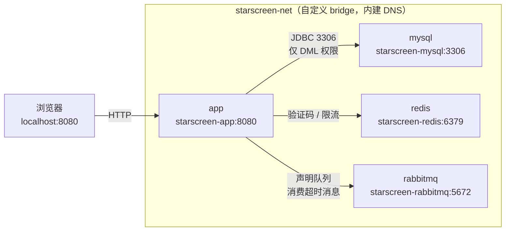

# 容器化部署（全家桶）

一份 `docker-compose.yml` 拉起星幕影票依赖的**全部**运行时组件：应用、MySQL、Redis、RabbitMQ。
不需要在宿主机装 JDK、Maven、MySQL、Redis 或 RabbitMQ。

```bash
cp .env.example .env          # 改掉 4 个 CHANGE_ME_* 密码
docker compose up -d --build
docker compose ps             # 等到四个服务都 healthy
open http://localhost:8080/   # Windows: start http://localhost:8080/
```

---

## 一、组件清单

| 服务 | 镜像 | 职责 | 容器内端口 | 宿主机端口 | 持久化 |
|---|---|---|---|---|---|
| `app` | 本地构建 `starscreen-ticketing:1.0.0` | Spring Boot 单体：页面渲染、下单锁座、支付回调、后台统计 | 8080 | 8080 | 无（无状态） |
| `mysql` | `mysql:8.0` | 唯一持久化数据源：用户、影片、影院、场次、座位、订单 | 3306 | 3307 | `starscreen-mysql-data` |
| `redis` | `redis:7-alpine`（实测 7.4.11） | 短信验证码（5 分钟 TTL）、发送限流（1 分钟 1 次）、防重放 nonce | 6379 | 6379 | `starscreen-redis-data`（AOF） |
| `rabbitmq` | `rabbitmq:3-management`（实测 3.13.7） | 延迟消息通道：TTL 队列 + 死信队列 + 超时消费者（**当前生产端未接线，见下文说明**） | 5672 / 15672 | 5673 / 15673 | `starscreen-rabbitmq-data` |

> **为什么宿主机端口是 3307 / 5673 / 15673？**
> 开发机上通常已经装了本地 MySQL（3306）和 RabbitMQ（5672/15672），映射到同一端口会直接
> `bind: address already in use`。容器之间走**服务名 + 容器内端口**，与宿主机端口无关；
> 宿主机端口只用于本机调试。想改就改 `.env` 里的 `*_HOST_PORT`。

### 构建镜像的两条路径

| 文件 | 做法 | 适用 |
|---|---|---|
| `Dockerfile`（默认） | 两阶段：`maven:3.9-eclipse-temurin-21` 编译 → `eclipse-temurin:21-jre` 运行 | 有镜像仓库访问权，宿主机不需要 JDK/Maven |
| `Dockerfile.prebuilt` | 单阶段：直接拷贝 `target/*.jar` | 离线/内网；CI 已产出 jar；拉不到 maven 构建镜像 |

切换方式：在 `.env` 里设 `APP_DOCKERFILE=Dockerfile.prebuilt`，再 `docker compose up -d --build`。

```bash
# 离线路径的完整命令
mvn -o clean package -DskipTests
docker build -f Dockerfile.prebuilt -t starscreen-ticketing:1.0.0 .
docker compose up -d          # 镜像已存在，不会再触发构建
```

两个文件共用同一套运行时设置（非 root 用户 `app`、`JAVA_OPTS`、健康检查、`ENTRYPOINT`），
所以换构建路径不会改变容器行为。

> 本机验收时用的是 `Dockerfile.prebuilt` 路径：所在网络的 Docker 镜像加速站点无法拉取
> `maven` 构建镜像。这是环境限制，不是配置问题——`Dockerfile` 本身是标准多阶段写法。

## 二、整体拓扑



三条通道对应代码里的真实依赖（RabbitMQ 目前只有「声明 + 消费」，没有生产，见下表末行）：

| 依赖 | 代码位置 | 用到的能力 |
|---|---|---|
| MySQL | `OrderService` / 各 `Repository` | 事务内 `UPDATE ... WHERE status='available'` 原子锁座 |
| Redis | `SmsService#sendCode/verifyCode`、`AntiReplayInterceptor` | `setIfAbsent` 限流、验证码 TTL、一次性核销 |
| RabbitMQ 拓扑 | `RabbitMQConfig` | 启动时声明 `order.exchange` / `order.queue`（TTL 600s + 死信）/ `order.delay.exchange` / `order.delay.queue` |
| RabbitMQ 消费 | `OrderTimeoutConsumer#handleOrderTimeout` | 常驻监听 `order.delay.queue`，收到消息即取消订单并释放座位 |
| 超时取消（**实际生效**） | `OrderService#cancelExpiredOrders`，`@Scheduled(fixedRate=30_000)` | 每 30 秒扫描 `pending` 订单，`createTime + 10min < now` 则改单并释放座位 |

> **⚠️ 一个真实的现状（与编排无关，但会影响你观察到的现象）**
> `OrderService.java:92` 注入了 `rabbitTemplate`，但全项目**没有任何 `convertAndSend` 调用**——
> 生产端没接线。所以队列总是空的，消费者虽然连上了却收不到消息；
> 真正完成「10 分钟未支付自动取消」的是上面那个 30 秒定时任务。
> 容器这套编排仍按 MQ 是真实依赖来处理（声明队列、拉起消费者），
> 将来补上生产端代码即可直接生效，无需改任何编排配置。
> 实测：把订单时间改成 11 分钟前，30 秒内状态变为 `cancelled`、座位回到 `available`。

## 三、依赖关系与失败模式

这也是为什么不能把四个服务平铺启动、只靠 `depends_on` 写个列表就完事：

| 组件缺失 | 应用启动 | 运行时表现 | 编排层的处理 |
|---|---|---|---|
| **MySQL** | **直接失败**。Hikari 建连超时 → `Cannot load driver` / `Communications link failure` | 无法启动 | `condition: service_healthy` 硬门控 |
| **Redis** | 能启动（Lettuce 懒连接） | 首页/选座正常，**手机验证码登录报错**；`SmsService` 抛连接异常 | 健康门控（避免带病上线） |
| **RabbitMQ** | 能启动。`@RabbitListener` 容器在后台线程重连，`main` 线程不受影响，日志刷 `AmqpConnectException` | 页面、下单、支付全部正常；**MQ 通道不可用**，但超时取消仍由 `@Scheduled` 完成 | 健康门控（保证队列声明成功、消费者就位，而不是带病上线） |

结论：MySQL 是**硬依赖**；Redis / RabbitMQ 是**软依赖**，缺失时应用照样启动、页面照样能开，
但会静默丢功能（验证码登录不可用 / MQ 通道不可用），排查成本比启动失败高得多。
所以三者都按 `healthy` 门控——宁可晚启动十几秒，也不让一个"半残"的应用对外提供服务。

## 四、启动顺序

编排层的顺序完全由健康检查驱动，不依赖 `sleep`：

```
① mysql 容器启动
     └─ 数据目录为空？→ 依次执行 01-schema.sql → 02-data.sql → 03-app-user.sh
     └─ 健康检查：ping + 「movie 表存在」双条件 → healthy

② redis 容器启动
     └─ 健康检查：redis-cli -a ***  ping == PONG → healthy

③ rabbitmq 容器启动
     └─ 健康检查：rabbitmq-diagnostics ping → healthy

④ app 容器启动（依赖 ①②③ 全部 healthy）
     └─ Spring 启动 → Hibernate 只做映射不做 DDL → 声明 exchange/queue
     └─ 健康检查：GET / 返回 200（要读库，能挡住假健康）→ healthy
```

按实测，冷启动到 `app healthy` 约 **60–90 秒**，其中 MySQL 首次初始化（建 10 张表 + 灌种子数据 + 展开 4000+ 座位）占大头。

**为什么 MySQL 健康检查要看表，而不是只看 `mysqladmin ping`？**
官方镜像首次初始化时，会先起一个 `--skip-networking` 的临时实例灌脚本，成功后才停掉它、
启动正式实例。只看 `ping` 或只看端口，可能在脚本还没跑完时就判为健康，应用抢先启动 →
`Table 'starscreen.movie' doesn't exist`（1146）。加一条 `information_schema` 查表判断可以彻底避免。

## 五、首次启动时数据库发生了什么

`docker-entrypoint-initdb.d/` 里的脚本**只在数据目录为空时执行一次**，按文件名排序：

| 顺序 | 文件 | 内容 | 执行身份 |
|---|---|---|---|
| 01 | `src/main/resources/schema.sql` | 10 张表 + 11 个索引 + 座位唯一键，全部 `CREATE TABLE IF NOT EXISTS` | root |
| 02 | `src/main/resources/data.sql` | 16 部影片、24 家影院、影厅、场次、按 `rows × cols` 递归展开座位、演示账号 | root |
| 03 | `docker/mysql/03-app-user.sh` | 创建 `starscreen_app@'%'`，**只授 SELECT/INSERT/UPDATE/DELETE** | root |

关键点：**应用账号没有 DDL 权限**。这与 `scripts/init-db.sql` 的最小权限策略一致。
没有使用镜像的 `MYSQL_USER` / `MYSQL_PASSWORD` 变量，因为那会执行 `GRANT ALL ON db.*`（含 CREATE/ALTER/DROP），
等于把改表结构的权力交给应用进程。

想重新初始化（改表结构、重置演示数据）：

```bash
docker compose down -v      # -v 删除数据卷
docker compose up -d
```

## 六、配置项

所有可调项集中在 `.env`（模板见 `.env.example`），compose 通过 `${VAR}` 注入：

| 变量 | 必填 | 默认 | 说明 |
|---|---|---|---|
| `MYSQL_ROOT_PASSWORD` | ✅ | — | 仅用于初始化与健康检查，应用拿不到 |
| `DB_NAME` / `DB_USERNAME` | | `starscreen` / `starscreen_app` | 库名与账号名 |
| `DB_PASSWORD` | ✅ | — | 应用账号密码，同时用于建号和 JDBC 连接 |
| `MYSQL_HOST_PORT` | | `3307` | 宿主机调试端口 |
| `REDIS_PASSWORD` | ✅ | — | Redis `requirepass` |
| `REDIS_HOST_PORT` | | `6379` | |
| `RABBITMQ_USERNAME` / `RABBITMQ_PASSWORD` | ✅（密码） | `starscreen` | 同时替代默认的 `guest/guest` |
| `RABBITMQ_HOST_PORT` / `RABBITMQ_MGMT_HOST_PORT` | | `5673` / `15673` | AMQP / 管理台 |
| `APP_HOST_PORT` | | `8080` | 业务入口 |
| `APP_DOCKERFILE` | | `Dockerfile` | 构建路径，可切 `Dockerfile.prebuilt` |
| `JAVA_OPTS` | | `-XX:MaxRAMPercentage=75.0 ...` | 堆跟随容器内存上限，不是宿主机内存 |

应用侧不需要改 `application.properties`：容器环境通过 Spring Boot 的外部化配置覆盖
（`SPRING_DATASOURCE_URL`、`SPRING_DATA_REDIS_HOST`、`SPRING_RABBITMQ_HOST` …），
配置文件里的 `localhost` 默认值只在裸机运行时生效。

> `DB_PASSWORD` 不建议包含单引号或反斜杠——它会被拼进初始化 SQL，脚本里已做显式拒绝并给出提示。

## 七、验证

```bash
# 1. 四个服务状态：app / mysql / redis / rabbitmq 应为 running / healthy
docker compose ps

# 2. 应用入口（应返回 200，页面含影片列表）
curl -s -o /dev/null -w "首页 HTTP %{http_code}\n" http://localhost:8080/
curl -s -o /dev/null -w "影片列表 HTTP %{http_code}\n" http://localhost:8080/movies

# 3. 数据库结构与数据（应看到 10 张表）
docker exec starscreen-mysql mysql -uroot -p"$MYSQL_ROOT_PASSWORD" -e \
  "SELECT COUNT(*) AS tables_cnt FROM information_schema.tables WHERE table_schema='starscreen';
   SELECT COUNT(*) AS movies FROM starscreen.movie;
   SELECT COUNT(*) AS seats FROM starscreen.seat;"

# 4. 应用账号确实没有 DDL 权限（应报 ERROR 1142）
docker exec starscreen-mysql mysql -ustarscreen_app -p"$DB_PASSWORD" starscreen \
  -e "CREATE TABLE __probe(id INT);"

# 5. Redis 连通
docker exec starscreen-redis redis-cli -a "$REDIS_PASSWORD" --no-auth-warning ping

# 6. RabbitMQ 队列由应用自动声明（应看到 order.queue / order.delay.queue 各 1 个，
#    order.delay.queue 有 1 个消费者；messages 恒为 0 是正常的，见「生产端未接线」说明）
docker exec starscreen-rabbitmq rabbitmqctl list_queues name messages consumers arguments
```

队列里出现 `x-message-ttl=600000` 与 `x-dead-letter-exchange=order.delay.exchange`，
说明 `RabbitMQConfig` 的声明在容器网络里真实生效，而不是本地才通。

## 八、日常运维

```bash
docker compose logs -f app             # 跟应用日志
docker compose logs -f mysql           # 看初始化脚本执行过程
docker compose restart app             # 只重启应用
docker compose up -d --build app       # 改完代码重新构建并替换（其余服务不动）
docker compose down                    # 停止并删除容器，保留数据卷
docker compose down -v                 # 连数据一起清空
docker stats                           # 各容器内存/CPU
```

管理台：<http://localhost:15673>（账号 `RABBITMQ_USERNAME` / `RABBITMQ_PASSWORD`）。

## 九、排障

| 现象 | 原因 | 处理 |
|---|---|---|
| `bind: address already in use` | 宿主机 8080/6379 等被占用 | 改 `.env` 里对应 `*_HOST_PORT` |
| app 卡在 `Created` 不启动 | 依赖未 healthy | `docker compose ps` 看哪个 unhealthy，再 `logs` |
| app 报 `Communications link failure` | MySQL 未就绪或密码不符 | 核对 `DB_PASSWORD`；`docker compose logs mysql` |
| app 报 `Table 'starscreen.movie' doesn't exist` | 曾用旧数据卷，初始化脚本未重跑 | `docker compose down -v` 后重来 |
| 页面时间整体差 8 小时 | 时区不一致 | 已统一 `TZ=Asia/Shanghai` + MySQL `+08:00` + JDBC `serverTimezone`；自建镜像需保留 `tzdata` |
| 中文变问号 / 变成 `空枪` | 客户端字符集不是 utf8mb4，中文被按 latin1 二次编码 | 两个 SQL 脚本开头已内置 `SET NAMES utf8mb4`，不依赖容器 locale；手工导入时仍建议加 `--default-character-set=utf8mb4` |
| 验证码登录报错、其余正常 | Redis 不可用 | `docker compose ps redis`；确认 `REDIS_PASSWORD` 一致 |
| 未支付订单 10 分钟后没被取消 | RabbitMQ 不可用或队列丢失 | 管理台看队列；确认 `rabbitmq-data` 卷存在 |

## 十、与生产环境的差距

这套 compose 的目标是「一条命令跑起来」，生产还需补齐：

1. **密码管理**：`.env` 换成 Docker secrets / K8s Secret / 云厂商参数仓库，不要落盘明文。
2. **数据库外置**：生产用托管 MySQL（RDS 等），把 `mysql` 服务从编排里摘掉，只保留 `SPRING_DATASOURCE_URL`。
3. **多副本**：`app` 无状态，可水平扩容，但需前置负载均衡；`docker compose up --scale app=3` 时
   注意去掉固定的 `container_name` 与宿主机端口映射。
4. **资源限制**：按机器规格补 `mem_limit` / `cpus`，并相应调整 `JAVA_OPTS` 与
   `--innodb-buffer-pool-size`（当前 256M）。
5. **可观测性**：接入集中式日志、指标（可加 `spring-boot-starter-actuator` 暴露 `/actuator/health` 供
   K8s probe 使用，替代当前的首页探测）。
6. **备份**：`mysqldump` 定时任务 + 卷快照；`rabbitmq-data` 卷只保证队列定义，不保证消息不丢。
